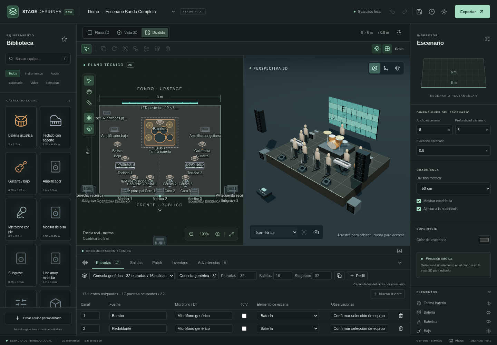

# Stage Designer Pro

Aplicación web de planificación escénica con un modelo métrico compartido por el plano SVG, la escena Three.js, las listas de audio y las exportaciones. Desarrollo inicial basado en la [especificación completa](docs/ESPECIFICACION.md).

Esta entrega desarrolla la primera aplicación funcional y parte de los módulos siguientes. El producto completo sigue en desarrollo; el alcance y la evidencia de cada capacidad se mantienen en la [matriz de implementación](docs/IMPLEMENTATION.md).



**Estado actual:** versión funcional en desarrollo con guías magnéticas, pivotes de giro e interferencias revisables. Pasan **142 pruebas de lógica/integración** y se verificaron los 16 flujos de navegador, incluido offline. Ver evidencia y límites en [PRUEBAS.md](docs/PRUEBAS.md). Los hitos 1–2 siguen como base verificada y el hito 3 continúa en desarrollo. La captura corresponde a la primera entrega; las capturas actuales de [anclajes](docs/anclajes-preview.png) y [capas](docs/capas-preview.png) se generaron durante las pruebas. [Vista de interferencias](docs/interferencias-preview.png).

## Probar la aplicación publicada

La publicación desde `main` usa el workflow **Verify and publish**: comprueba el código y despliega el artefacto en GitHub Pages. El enlace del sitio y el resultado están en **Actions** y **Settings → Pages** del repositorio. Si Pages no está habilitado, elegir **Source: GitHub Actions**. [Instrucciones completas](docs/DEPLOYMENT.md). La configuración remota y el despliegue todavía deben confirmarse; subir código no demuestra que el sitio esté disponible.

## Requisitos y ejecución

- Node.js 24 y npm 11, utilizados en el entorno de desarrollo.
- Navegador moderno con IndexedDB. La vista 3D necesita WebGL.
- No se necesita cuenta, servidor de base de datos ni claves de API para las funciones locales.

Desde la raíz del repositorio:

```sh
npm ci
npm run dev
```

Vite usa el puerto 5173. El terminal informa la dirección disponible. En el entorno de onboarding se valida el servidor con solicitudes locales; la publicación del entorno se realiza por separado desde la configuración de la plataforma.

Para compilar y comprobar el resultado de producción:

```sh
npm run build
npm run preview
```

El directorio `dist/` contiene los recursos para servir la aplicación estática. El service worker y la instalación PWA requieren HTTPS o un contexto local seguro; su comportamiento debe validarse con la compilación de producción, no suponerse por ejecutar el servidor de desarrollo.

## Pruebas

```sh
npm run typecheck
npm test
npm run test:e2e
```

Playwright usa `/usr/bin/chromium` si está disponible, o el ejecutable indicado por `CHROMIUM_PATH`. En otra máquina, ejecutar `npx playwright install chromium` (y preparar las dependencias del sistema) antes de E2E. `npm run test:e2e` compila y sirve producción automáticamente en el puerto 4173.

Vitest cubre lógica de dominio y persistencia. Playwright verifica flujos del navegador. Las instrucciones y resultados reales se registran en [PRUEBAS.md](docs/PRUEBAS.md); disponer de un comando no significa que su ejecución haya pasado.

## Uso inicial

1. Crear un proyecto o abrir **Demo — Escenario Banda Completa**.
2. Configurar ancho, profundidad y elevación del escenario.
3. Agregar elementos del catálogo y modificar su posición, dimensiones y rotación.
4. Utilizar el plano, la vista 3D o ambas vistas; las dos consumen el mismo proyecto.
5. Organizar equipos desde **Capas** en el inspector: crear, renombrar, asignar, ocultar o bloquear conjuntos de una disciplina. Ocultar conserva el inventario y las fuentes de audio.
6. Seleccionar un objeto y elegir su **Soporte físico**. Anclar conservando posición o activar **Apoyar sobre la cara superior**; editar las coordenadas relativas para ajustar su ubicación dentro del conjunto.
7. Seleccionar varios elementos con Shift y usar alineación o distribución de centros en X/Y. Los soportes, sus descendientes y los grupos se desplazan como unidades.
8. Completar fuentes y perfiles de audio en el panel técnico.
9. Guardar y exportar un respaldo editable antes de trasladar el proyecto a otro navegador o dispositivo.

La demo utiliza dimensiones de equipos genéricos. No representa fichas técnicas verificadas de fabricantes. Las advertencias geométricas o de audio sirven para revisar el diseño; no certifican rigging, instalaciones eléctricas ni cobertura acústica.

## Datos locales y respaldos

Los proyectos se almacenan en IndexedDB, dentro del navegador y del origen donde se abrió la aplicación. Limpiar los datos del sitio, cambiar de origen o utilizar otro perfil de navegador puede dejar esos proyectos inaccesibles. Exportar un archivo de proyecto es la forma de conservar una copia externa. Un PDF, PNG o SVG no reemplaza el respaldo editable.

El formato actual es `.stagepro` JSON con `schemaVersion: 3`. Se validan y migran documentos de los esquemas 1 y 2 sin alterar geometría, IDs ni audio. La versión 3 guarda pivotes y revisiones de interferencias. Leer una revisión antigua conserva intacta su instantánea original. Duplicar un proyecto conserva los pivotes y comienza un historial de interferencias nuevo.

Las instancias conservan una copia de la definición del equipo utilizada. Cambiar una definición del catálogo no debe modificar silenciosamente los proyectos ni sus revisiones anteriores.

## Desarrollo

| Ruta | Responsabilidad |
| --- | --- |
| `src/app/` | Pantallas, paneles y operaciones de usuario |
| `src/core/` | Entidades, geometría, unidades y estado del editor |
| `src/editor-2d/` | Plano interactivo y símbolos SVG |
| `src/editor-3d/` | Cámaras, transformaciones y modelos procedurales |
| `src/catalog/` | Definiciones genéricas y biblioteca |
| `src/audio/` | Fuentes, patch, salidas y validaciones |
| `src/documents/` | Derivación de planos, tablas y archivos |
| `src/storage/` | IndexedDB, validación e instantáneas |
| `tests/e2e/` | Flujos de navegador |

Ver [arquitectura y modelo de datos](docs/ARQUITECTURA.md), [decisiones](docs/DECISIONES.md) y [continuidad](docs/CONTINUIDAD.md).

## Alcance pendiente

La importación GLB/glTF, los modelos comerciales verificados, los puntos de conexión y la rotación física en tres ejes, el grafo de señal, las plantillas editoriales, XLSX y el render de alta fidelidad forman parte del plan. La matriz detalla también las extensiones de cada módulo ya iniciado; no se consideran terminadas por tener una estructura de datos o un control visible.

## Precisión y revisión física

- **Guías magnéticas** en el plano: acercar centros o bordes de equipos visibles para alinearlos. Se activan independientemente de la cuadrícula; Alt suspende ambos ajustes durante el arrastre. Los campos numéricos conservan el valor escrito.
- **Pivote de giro** en Propiedades: centro, esquinas o coordenadas locales. Cambiarlo no mueve el equipo; los giros conservan ese punto fijo en 2D y 3D.
- **Advertencias → Interferencias físicas**: localizar equipos, registrar un motivo para una superposición intencional o reabrirla. Cambiar la geometría devuelve la advertencia y conserva el registro anterior. El PDF incluye las observaciones y su historial.

Las comprobaciones usan los prismas físicos declarados y cada gabinete de line array; no equivalen a colisiones de mallas detalladas. Zonas restringidas, altura de recinto y validación general de apoyos siguen pendientes.
