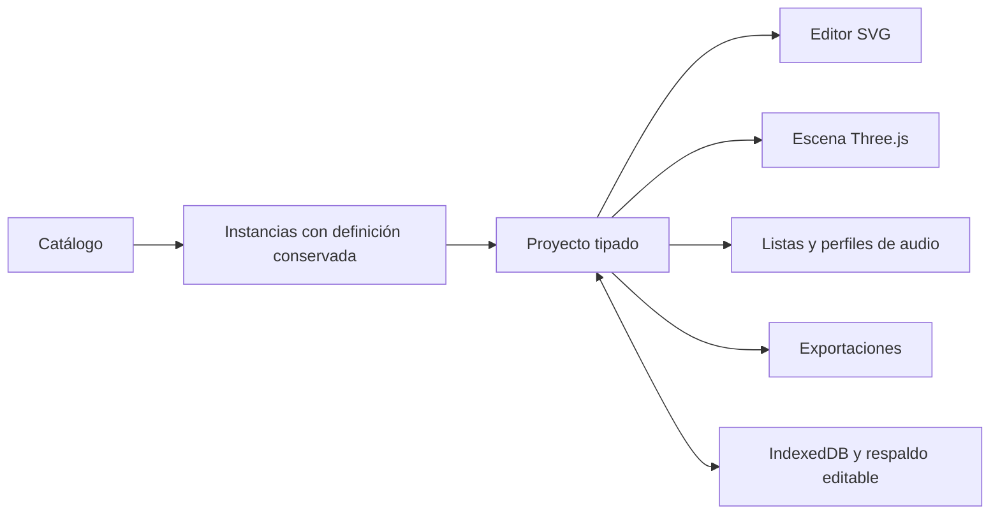

# Arquitectura y modelo de datos

## Límites de módulos

El proyecto es el documento de dominio. SVG, Three.js, inventario y audio lo leen; sus representaciones visuales no son otra base de datos. `src/core/types.ts` define el contrato compartido. La geometría se mantiene independiente de React y Three.js para poder probarla y reutilizarla en exportaciones o una futura aplicación de escritorio.

`Zustand` mantiene el proyecto abierto, la selección, la vista, el historial y el estado de cambios. Las operaciones de dominio producen versiones del proyecto para deshacer y rehacer. Las cámaras, el zoom y los paneles son estado de presentación; cambiar de cámara no modifica dimensiones físicas.

## Coordenadas y unidades

Todas las longitudes del modelo se almacenan en metros. La interfaz puede convertir unidades en los límites de entrada y presentación; el zoom nunca interviene en esas conversiones.

| Eje del proyecto | Significado | Eje Three.js |
| --- | --- | --- |
| X | Horizontal, positivo hacia izquierda escénica | X |
| Y | Profundidad, positivo hacia el fondo | −Z |
| Z | Altura sobre el piso del recinto | Y |

El origen XY es el centro del borde delantero. La plataforma ocupa `[-width/2, width/2] × [0, depth]`; su cara superior está en `stage.height`. Cada instancia usa el centro de su huella en XY y el borde inferior en Z. Para apoyar un equipo sobre el escenario se usa `position.z = stage.height`.

La rotación del proyecto se expresa en grados alrededor de Z. Three.js aplica el mismo signo alrededor de Y después de convertir a radianes. El SVG invierte la profundidad hacia arriba de la pantalla. Estas conversiones se centralizan en el núcleo o en el adaptador de visualización; no se guardan coordenadas de cámara dentro de las posiciones del proyecto.

Cambiar el ancho o la profundidad del escenario modifica la plataforma, nunca las dimensiones ni las posiciones de sus equipos. Estar fuera de su huella produce una advertencia revisable: una consola FOH o un PA lateral pueden estar allí intencionalmente.

## Entidades actuales

| Entidad | Datos y responsabilidad |
| --- | --- |
| `EquipmentDefinition` | ID de catálogo, versión, tipo, categoría, dimensiones, color y origen genérico o ingresado por usuario |
| `SceneObject` | ID de instancia, etiqueta, definición conservada, dimensiones, posición mundial, giro, banderas individuales, `parentId`, `groupId`, `layerId` y parámetros |
| `SceneLayer` | ID, nombre y banderas de visibilidad/bloqueo colectivas; máximo 64 capas por proyecto |
| `Stage` | Ancho, profundidad, elevación, cuadrícula, snap y color |
| `AudioSource` | Fuente técnica estable, objeto opcional, nombre, captador, phantom y notas |
| `AudioInput` | ID estable, fuente referenciada, canal lógico, puerto físico y bloqueo de asignación |
| `AudioOutput` | Canal de salida, nombre, bus, mono/estéreo y uno o varios destinos |
| `AudioProfile` | Capacidad genérica declarada, entradas de stagebox, patch propio y salidas |
| `Project` | Versión 3 del esquema, metadatos, escenario, capas, objetos, fuentes, perfiles y perfil activo |
| `ProjectRevision` | ID, proyecto de origen, nombre, fecha e instantánea completa |

Los números visibles de canales son editables y no reemplazan IDs. Las fuentes pertenecen al proyecto; el patch pertenece a cada perfil. Cambiar un perfil de consola no borra fuentes ni transforma la escena.

## Jerarquías y operaciones de edición

`groupId` y `parentId` distinguen grupos de edición y relaciones de soporte físico. El inspector permite anclar/desanclar y muestra la jerarquía en la lista de escena. Anclar conserva posición y giro mundiales, salvo que se active el apoyo sobre la cara superior: entonces sólo cambia la altura inferior del objeto y sus descendientes. La demo contiene una batería apoyada en tarima.

El módulo `core/hierarchy.ts` calcula descendientes y transforma un borrador completo antes de publicarlo en el store. Traslación, giro alrededor de Z y cambios de altura del soporte se propagan por todos los niveles una sola vez, incluso si padre e hijo están seleccionados a la vez. Se rechazan autoanclajes, ciclos, soportes inexistentes y operaciones que excedan límites físicos.

Las coordenadas relativas no son otro documento almacenado: se calculan a partir de las posiciones mundiales y del giro del soporte. Su origen es el centro inferior del soporte. Editarlas modifica sólo ese objeto y sus descendientes, sin mover hermanos de grupo. La opción **Editar solo este elemento** del inspector permite asimismo ajustar un miembro de grupo. Los pivotes de giro XY son configurables. Otros puntos de conexión y la rotación física en tres ejes siguen pendientes.

La alineación y distribución agrupan la selección en unidades independientes, fusionando grupos y subárboles relacionados. Alinear lleva sus centros al promedio del eje elegido. Distribuir requiere al menos tres unidades, mantiene los centros extremos y espacia los intermedios uniformemente. Esto no equivale a calcular huecos libres iguales entre objetos de tamaños distintos. Cada operación forma una única entrada de historial.

El centro de una unidad es el promedio de las posiciones de sus raíces físicas, incluyendo los miembros de grupo expandidos aunque sólo se haya seleccionado uno. Los descendientes acompañan a sus soportes sin desplazar ese centro de referencia. Elegir otro miembro del mismo grupo produce la misma alineación.

`mutateProject` separa los comandos discretos de los gestos: cancela el arrastre incompleto antes de duplicar, borrar, agrupar, alinear o editar capas. Sólo las actualizaciones continuas de posición/giro mantienen la transacción. El desmontaje de un gizmo no puede revertir el comando siguiente ni dejar selecciones con IDs de copias descartadas.

## Capas y bloqueos efectivos

`core/layers.ts` centraliza visibilidad y bloqueo. Un objeto está oculto si su propia bandera o la de su capa está activa; el bloqueo usa la misma combinación. Desbloquear una capa conserva los bloqueos individuales. Las banderas no se heredan del soporte: una pantalla puede permanecer visible aunque la capa de su estructura esté oculta.

Los controles numéricos, SVG y gizmos 3D respetan el bloqueo efectivo. Si una operación sobre un soporte/grupo movería un descendiente bloqueado, se rechaza entera; no se mueven parcialmente sus miembros. El store comunica el motivo mediante `notice`. Los arrastres conservan transacciones atómicas y al ocultar/bloquear durante un gesto se cancela la transformación antes de registrar el cambio de capa.

Las capas iniciales corresponden a Instrumentos, Audio, Escenario, Video y Personas. Se pueden crear, renombrar, asignar a una selección, ocultar, bloquear y eliminar. Eliminar una capa deja sus objetos sin capa y conserva relaciones, geometría y señales; deshacer recupera la asignación. La vista **Sin capa** no crea una entidad adicional.

## Geometría paramétrica

Las pantallas modulares derivan su ancho, alto y profundidad de las dimensiones del gabinete y la cantidad de columnas y filas. El inventario cuenta gabinetes, no solamente una pantalla contenedora.

Los line arrays se modelan como gabinetes individuales con dimensiones y ángulo entre cajas. Sus límites deben derivarse de la disposición final de los gabinetes. Cada lado es una instancia independiente. Los parámetros genéricos no constituyen una validación de compatibilidad de flybars, carga ni cobertura acústica.

## Persistencia y formato

IndexedDB almacena proyectos e instantáneas mediante Dexie. Un guardado reemplaza el documento completo de forma atómica. Los importadores validan el esquema antes de abrir un documento. Los IDs y referencias deben ser coherentes; una importación no puede sobrescribir silenciosamente otro proyecto.

El guardado actual usa `schemaVersion: 3` en archivos `.stagepro` con JSON editable; también se acepta `.json`. El lector valida los esquemas 1, 2 y 3. Para migrar 1→2 valida primero el documento antiguo, luego añade las cinco capas iniciales y asigna objetos por categoría, conservando IDs, geometría, audio y fechas. Versiones desconocidas se rechazan. `loadProject`, `listProjects`, `loadRevision` y `listRevisions` exponen documentos normalizados; leer una revisión v1 no reescribe su instantánea en IndexedDB. La migración 2→3 añade un historial de interferencias vacío sin mover objetos. Los pivotes ausentes mantienen el giro centrado. Un guardado de proyecto usa v3. La versión de las tablas Dexie permanece en 1: el cambio corresponde al documento, no a nuevos índices.

Al duplicar un proyecto se generan también IDs nuevos de capas y se remapean sus objetos. El esquema valida referencias de capas, duplicados y el límite de 64. Las definiciones de equipos siguen incluidas en cada instancia. El archivo nativo todavía no es un ZIP ni contiene recursos externos; las migraciones de futuras versiones deberán implementarse por separado.

Deshacer/rehacer y revisión son conceptos distintos: el historial es de la sesión de edición; una revisión es una instantánea conservada. La aprobación documental, las comparaciones y la asociación de archivos exportados a revisiones necesitan metadatos adicionales.

## Exportaciones

Las exportaciones se calculan desde un proyecto coherente y el perfil de audio activo. SVG, PNG del plano y el dibujo PDF omiten objetos ocultos individualmente o por capa, incluso para calcular el encuadre. El inventario y las tablas de audio conservan todos los equipos y señales: ocultar es una decisión visual. Bloquear una capa no modifica las exportaciones. El SVG conserva vectores; PNG representa una imagen; PDF combina geometría y texto/tablas; CSV representa datos técnicos. El archivo editable mantiene el modelo necesario para seguir trabajando.

Una representación ajustada a página conserva proporciones pero no declara una escala física fija. Las escalas de impresión 1:25, 1:50 y 1:100 requieren tamaños físicos de papel, control del área imprimible y pruebas específicas antes de anunciarse.

## Evolución prevista

- Recursos vinculados con hashes, procedencia/licencia y almacenamiento local, antes de importar GLB.
- Puntos de conexión configurables, además de los pivotes XY y la jerarquía actual de traslación/giro Z y altura; presets reutilizables de capas.
- Entorno del recinto separado de `Stage`, con zonas, alturas y obstáculos.
- Puertos físicos, conectores y aristas de un grafo de señales, separando consolas, stageboxes y buses.
- Phantom con estados requerido/no requerido/según dispositivo/sin confirmar.
- Revisión documental con estados y referencias a archivos generados.
- Adaptadores de fabricante exclusivamente cuando existan formatos y especificaciones verificables.

## Guías, pivotes e interferencias

`snapping.ts` congela referencias al comenzar el arrastre y busca centros/bordes de las huellas envolventes en cada eje. Excluye el conjunto en movimiento y referencias ocultas. El umbral es de 7 píxeles convertido a metros; las guías prevalecen sobre la cuadrícula sólo en los ejes coincidentes. No se aplica ajuste a campos numéricos.

`rotationPivot` es un desplazamiento XY en los ejes locales respecto del centro inferior. Al girar sin posición explícita, `hierarchy.ts` compensa la posición para conservar el pivote mundial. El gizmo 3D se ubica en ese punto, con la geometría desplazada inversamente dentro del grupo; una traslación se convierte otra vez al centro inferior del documento.

`collisions.ts` usa cajas envolventes como descarte inicial y SAT sobre prismas orientados, incluyendo la inclinación de cada gabinete de array. Un contacto de hasta 0,1 mm no cuenta como penetración. Capas ocultas, grupos y anclajes no eliminan equipos del análisis. La lista muestra hasta 500 interferencias, informa el total y avisa cuando hay más.

`validation.ts` combina audio, límites e interferencias para la interfaz y PDF. Una revisión guarda IDs, firma geométrica, motivo y fecha; reabrir añade `revokedAt`. Cambiar posición/giro/dimensiones invalida la revisión para la nueva geometría. Renombrar, ocultar o bloquear no modifica la firma. Eliminar un equipo limpia las referencias a sus revisiones; deshacer y las instantáneas conservadas recuperan el estado anterior. Duplicar proyecto inicia su historial de interferencias vacío.
